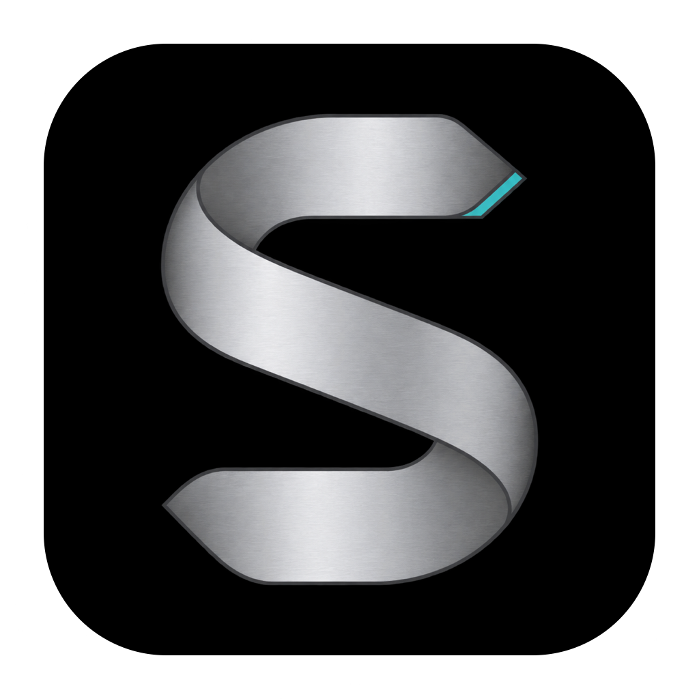

# Stainless



An unblocked browser.

Stainless is a free, Chromium-based browser project for developers, agent builders and
privacy-conscious users. It is donation/sponsorship funded, without ads, sponsored placements,
behavioral tracking or a mandatory account.

## Status

**Unsigned private preview candidates are downloadable. Phase 1 verification is still in progress.**

The repository includes pinned Chromium/depot_tools sources, a focused downstream patch stack,
a Rust build/release coordinator, a native macOS updater and synthetic tests. Chromium history
is fetched outside this checkout.

**The full Chromium source build and isolated browser smoke checks now pass locally.**
The actual DMG installs and browses after eject in an isolated local test directory.
Download previews from the [private releases](https://github.com/mbianchidev/stainless/releases).
Separate clean-Mac verification and the authorized automatic N-to-N+1 update remain open.
Local checks are not a completed phase. Track actual release gates in
[the Phase 1 contract](docs/phase-one.md#release-evidence) and
[epic #1](https://github.com/mbianchidev/stainless/issues/1).

This checkout targets the de-googled preview baseline. **Google-backed threat/reputation and
password-leak checks have no replacement yet.** See
[removed services, compatibility and replacement gaps](docs/degoogling.md) before using it.

## Build locally

Start on Apple Silicon macOS with full Xcode 26.6+, macOS SDK 26.5+, APFS and substantial free disk.
The entry point verifies or locally installs pinned Rust 1.99.1. Xcode is required on the build
Mac only, not for installed browsing; no paid Apple account or signing credential is needed.

```sh
git clone git@github.com:mbianchidev/stainless.git
cd stainless
./tools/stainless doctor
./tools/stainless bootstrap
./tools/stainless build
./tools/stainless test
./tools/stainless package
```

See [build prerequisites, commands, caches and publication](docs/build-macos.md) before fetching
Chromium. Preview packages are unsigned/unnotarized; installation/update/recovery guidance is
in [the macOS guide](docs/install-macos.md).

## Documentation and scope

- [Phase 1 baseline, boundaries and outstanding release gates](docs/phase-one.md).
- [Clean-user automatic-update verification](docs/update-verification.md).
- [Opt-in profile ownership and migration groundwork](docs/profile-isolation.md).
- [Delivery phases, v1 features and non-goals](docs/roadmap.md).
- [Historical decisions Q&A](docs/decisions-q-and-a.md).
- [Execution epic and capability issues](https://github.com/mbianchidev/stainless/issues/1).

Phase 1 retains ordinary Chromium browsing. Encrypted profiles, custom privacy modes, Tor,
agents, enhanced DevTools, AI and clean-search transforms are later features, not current
privacy guarantees. Linux/Windows are later targets; mobile is outside v1.

## Contributing and license

Start with the epic and owning issue; follow the [working conventions](docs/roadmap.md#working-conventions).
For engine/build/release work, follow [Chromium maintenance](docs/build-macos.md#maintaining-chromium).
The repository stays private. Contribution/disclosure policy and public readiness are tracked
in [#27](https://github.com/mbianchidev/stainless/issues/27).

Stainless copyright is held by **Synctune Open**.
No Stainless license has been selected. Do not assume it is open-source licensed.
Required Chromium/Rust notices still apply to private preview redistribution.
