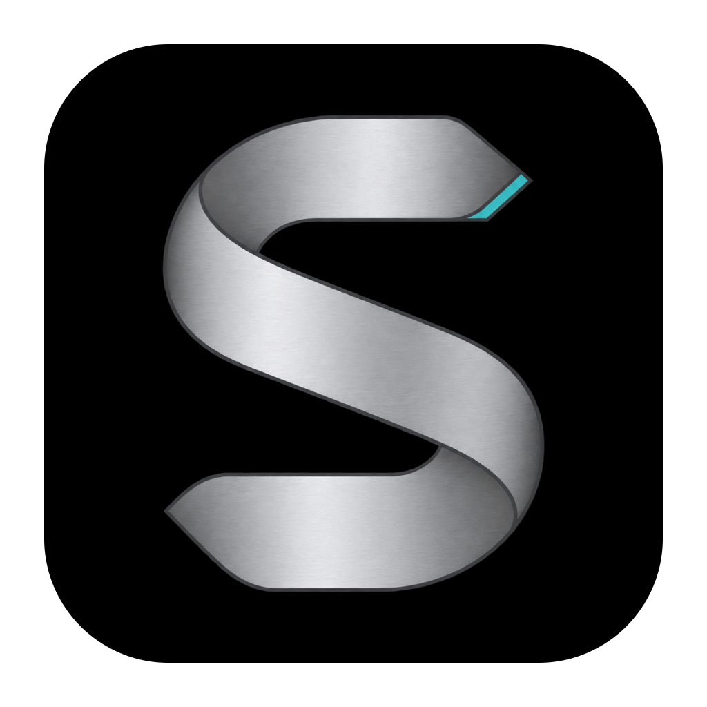

<p align="center">
  
</p>

<h1 align="center">Stainless</h1>

<p align="center">
  <a href="https://github.com/stainless-browser/stainless/actions/workflows/ci.yml"></a>
  <a href="https://github.com/stainless-browser/stainless/actions/workflows/release.yml"></a>
  <a href="https://github.com/stainless-browser/stainless/releases"></a>
  <a href="LICENSE"></a>
</p>

<p align="center">
  <a href="docs/README.md">Docs</a> ·
  <a href="https://github.com/stainless-browser/stainless/releases">Releases</a> ·
  <a href="https://github.com/stainless-browser/stainless/issues">Issues</a> ·
  <a href="docs/roadmap.md">Roadmap</a>
</p>

Stainless is a free, Chromium-based browser for developers, agent builders and
privacy-conscious people. The goal: use the web without ads, sponsored placements,
behavioral tracking or a mandatory account.

It is a work in progress. Today Stainless is the real Chromium browser for Apple Silicon
Macs, built from a pinned source revision with Google's built-in services removed and an
opt-in updater. Identities, privacy controls, local AI and auditable agents arrive in later
phases of the [roadmap](docs/roadmap.md). Stainless is meant to be supported by donations
and sponsorships in the future.

## Contents

- [Quickstart](#quickstart)
- [Why Stainless](#why-stainless)
- [How it works](#how-it-works)
- [Get started](#get-started)
- [Features](#features)
- [Documentation](#documentation)
- [AI policy](#ai-policy)
- [Contributing](#contributing)
- [Security](#security)
- [License](#license)

## Quickstart

### Install a preview

Previews are unsigned, unnotarized prereleases for Apple Silicon Macs. Builds target
macOS 13.0 or newer, but only macOS 26.6 has been verified.

1. From [Releases](https://github.com/stainless-browser/stainless/releases), download the newest
   `Stainless-VERSION-macos-arm64.dmg` and its `SHA256SUMS`.
2. Compare the image's hash with its `SHA256SUMS` entry:

   ```sh
   shasum -a 256 Stainless-VERSION-macos-arm64.dmg
   ```

3. Open the image, drag **Stainless** to **Applications**, eject the image and launch
   Stainless from Applications.
4. If macOS blocks the first launch because the app is not notarized and your hash matched,
   use Apple's per-app exception: after trying to open it once, go to **System Settings >
   Privacy & Security** and click **Open Anyway**
   ([Apple guide](https://support.apple.com/en-us/102445)). Never disable Gatekeeper, and do
   not open an app that macOS reports as damaged or malware.

Stainless opens a normal Chromium browser window, and **About Stainless** shows the
installed Stainless version, then the Chromium version it is built on. Browsing needs no
account, Xcode or developer tools.

Before relying on it, read [feature availability](docs/degoogling.md):
**Google Safe Browsing and Google's password-leak checks are removed.** Published previews
have no replacement; current source adds on-device
[threat lists and opt-in breach checks](docs/threat-protection.md).
Each release names its Chromium version, and previews can lag behind Chromium security
releases ([status](docs/status.md)). The [macOS install guide](docs/install-macos.md)
covers `.dmg.zip` downloads, updates, recovery and removal.

### Build from source

You need an Apple Silicon Mac with full Xcode 26.6 or newer (license accepted, Metal
Toolchain component installed), the macOS 26.5 SDK or newer, an APFS volume, 16 GiB of
memory (32 GiB recommended) and at least 100 GiB of free disk (reserve 300 GiB).
`./tools/stainless` installs the pinned Rust 1.99.1 toolchain if needed. No paid Apple
account or signing credential is required.

```sh
git clone https://github.com/stainless-browser/stainless.git
cd stainless
./tools/stainless doctor     # check Apple Silicon, Xcode, SDK, Metal, Rust, memory and disk
./tools/stainless bootstrap  # fetch pinned Chromium and apply the patch stack (can take hours)
./tools/stainless build      # build Chromium, ChromeDriver and the updater
```

A successful build leaves `Stainless.app` in
`~/Library/Caches/StainlessBuild/chromium/REVISION/src/out/Stainless/`.
`./tools/stainless build`, `test` and `package` launch native AppKit (and, for `test` and
`package`, browser) processes, so run them only on a
[dedicated macOS test host or VM](docs/build-macos.md#native-macos-gui-test-isolation).
The [build guide](docs/build-macos.md) has the details.

## Why Stainless

- **Real Chromium, not a wrapper.** Stainless builds Chromium's full `chrome` target from a
  pinned revision. It is not Electron, a system WebView or a rebranded binary, and it keeps
  Chromium's sandboxing, site isolation and certificate validation.
- **No Google services built in.** Sign-in, sync, Safe Browsing and other Google-backed
  services are removed. Search falls back to DuckDuckGo until you pick a provider, metrics
  consent is forced off and Stainless adds no telemetry endpoint.
- **Separate from Chrome.** Stainless has its own app identity, profile folder and Keychain
  items, and never imports Chrome or Chromium data implicitly.
- **Auditable.** The Chromium revision, toolchains and every downstream patch are pinned and
  reviewable here. Each package ships build manifests, checksums and third-party notices.

Tradeoffs to know about:

- Previews are unsigned, unnotarized, Apple Silicon only and still in Phase 1 verification.
- Without Safe Browsing you get fewer automated phishing and malware warnings. Current
  source blocks domains on public threat lists, but cannot scan downloads or recognize new
  dangerous pages.
- Automatic updates trust HTTPS and GitHub, not signed update metadata. Published previews
  need a read-only GitHub token; current source checks public releases without one.
- Widevine and proprietary codecs are not included.
- Removing Google services is not a complete privacy product. Encrypted profiles, privacy
  containers, fingerprint protection and Tor are later roadmap work.

## How it works

Chromium's source lives outside this repository. Stainless maintains a small layer on top:

| Path | Role |
| --- | --- |
| [`chromium/manifest.json`](chromium/manifest.json) | Pins Chromium, `depot_tools`, Rust, the product version and the ordered patch list |
| [`chromium/patches/`](chromium/patches/) | Downstream patches: identity, branding, Google-service removal and Stainless features |
| [`tools/stainless`](tools/stainless) | Entry point for the Rust build and release coordinator in [`tools/xtask`](tools/xtask/) |
| [`components/updater`](components/updater/) | Rust updater and the native macOS menu-bar helper |
| [`components/release`](components/release/), [`components/profiles`](components/profiles/) | Shared update-feed validation and managed-profile ownership |

`bootstrap` fetches the pinned Chromium into `~/Library/Caches/StainlessBuild` and applies
the patches. `build` compiles the browser and helpers. `package` produces the DMG, update ZIP,
feed, checksums and notices. The installed updater checks GitHub Releases, verifies the
SHA-256 of a newer preview and installs it on restart, keeping the previous app and profile
snapshots for rollback.

Releases are maintainer-only. [`scripts/release.sh`](scripts/release.sh) builds and packages
locally, uploads a draft release and pushes the tag. Tag-triggered release CI on a hosted
runner then verifies the assets, provenance, dependency audit and Chromium freshness before
publishing. See [releasing](docs/releasing.md) and the
[Phase 1 architecture](docs/phase-one.md).

## Get started

After installing a preview:

- **Updates.** Click the **S** icon in the menu bar. Published previews need **Authorize
  Private Updates** and a fine-grained GitHub token with **Contents: Read-only** access;
  current source checks public releases without a token. Stainless checks at startup and
  every four hours. See [automatic updates](docs/install-macos.md#automatic-updates).
- **Search.** DuckDuckGo is the fallback until you choose a search engine in Settings.
- **Your data.** The profile lives in `~/Library/Application Support/Stainless` and caches in
  `~/Library/Caches/Stainless`. See [backups and recovery](docs/install-macos.md#backups-and-recovery)
  and [removing Stainless](docs/install-macos.md#remove-stainless).

When building from source:

- `./tools/stainless help` lists every coordinator command.
- `--jobs N` (1 to 64, default 8) limits build parallelism.
- `STAINLESS_CACHE_DIR` moves the Chromium cache to another absolute, whitespace-free APFS path.
- `./tools/stainless security-status` checks the Chromium pin against current Mac Stable.

The [build guide](docs/build-macos.md) covers caches, CI, Chromium maintenance and packaging.

## Features

**In published previews** (newest: 0.1.0-preview.8):

- Everyday Chromium browsing: tabs and windows, bookmarks, history, find and zoom, downloads,
  print and PDF, settings, Incognito and DevTools.
- Built-in Google services removed, with the [gaps documented](docs/degoogling.md).
- A separate Stainless profile and Keychain identity.
- Opt-in automatic updates with hash verification and failed-launch rollback.
- A [command palette](docs/build-macos.md#browser-command-palette) (**Command+Shift+P**), a
  [keyboard shortcut editor](docs/build-macos.md#profile-keyboard-shortcuts) and
  [portable keymaps](docs/keymaps.md).
- [Managed Standard and Incognito profiles](docs/profile-isolation.md) with a native chooser,
  cold backup and restore, and startup Safe Mode.
- A [resource overview](docs/resource-overview.md) with safe hibernate and end-process controls,
  [local-only saved history](docs/history-privacy.md) and
  [`stainless://` addresses](docs/internal-urls.md).
- Experimental, opt-in [self-hosted Web Push](docs/web-push-self-hosting.md) and
  [local services](docs/local-services.md) for translation, speech, captions and OCR.

Planned work, from identities and a vault to clean search, Tor, agents and local AI, is in
the [roadmap](docs/roadmap.md). [Project status](docs/status.md) tracks what is verified.

## Documentation

The [docs index](docs/README.md) links everything:

- **Users:** [install and update](docs/install-macos.md), [status](docs/status.md),
  [feature availability](docs/degoogling.md) and [profiles](docs/profile-isolation.md).
- **Developers:** [contributing](CONTRIBUTING.md), [building](docs/build-macos.md),
  [releasing](docs/releasing.md) and [agent instructions](AGENTS.md).

## AI policy

You are responsible for everything you contribute, including AI-assisted code, docs and
assets. Review and test your contribution, and be ready to explain what the code does and
why it is needed.

## Contributing

Contributions are welcome. Read [CONTRIBUTING.md](CONTRIBUTING.md) to set up, find work and
open a pull request. Coding agents start with [AGENTS.md](AGENTS.md). Stainless has a single
maintainer and follows a benevolent-dictator governance model. Everyone taking part follows
the [Code of Conduct](CODE_OF_CONDUCT.md). See [accessibility](ACCESSIBILITY.md) for how we
handle accessibility barriers.

## Security

Report vulnerabilities privately as described in the [security policy](SECURITY.md), never in
public issues. Only the newest published preview receives security fixes.

## License

Stainless is licensed under the [Apache License 2.0](LICENSE), copyright **Synctune Open**.
Contributions are accepted under the same license. Chromium and other bundled components keep
their own licenses; their notices ship with each release.
