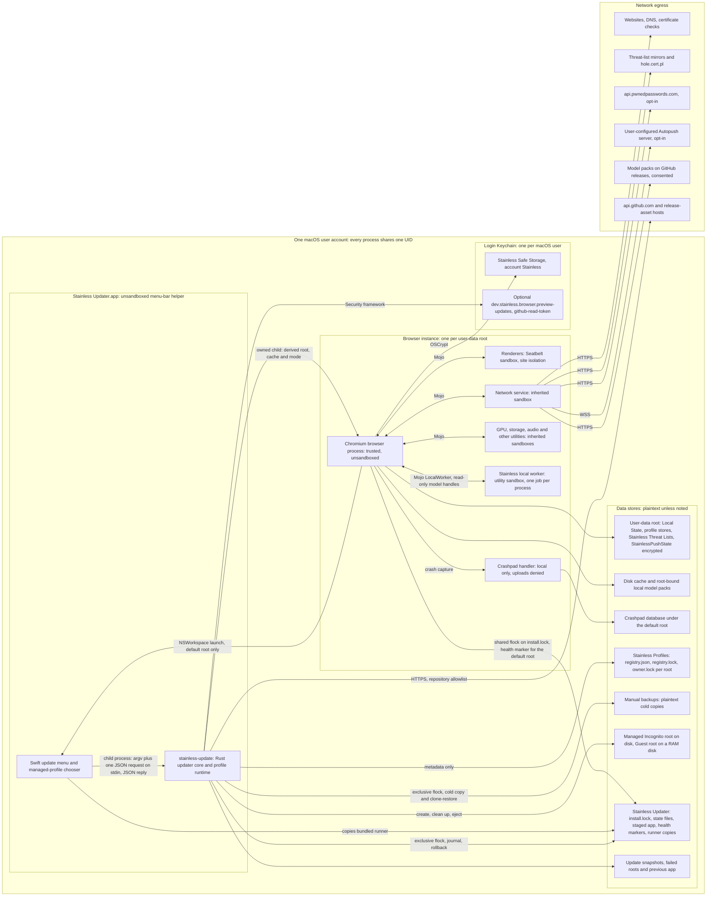

# Architecture and threat model

*Current source.* This is the first bounded slice of
[#4](https://github.com/stainless-browser/stainless/issues/4). It maps every process, IPC
boundary, key boundary and data store that the repository implements today. It then maps each
threat to its current mitigation, test and residual risk. It adds no isolation, encryption or
service, and it does not complete #4.

Claims follow implementation ([global decisions](roadmap.md#global-decisions)). "Implemented"
means present in current source with the cited code. It does not mean that an installed preview
has it ([project status](status.md)) or that [release evidence](phase-one.md#release-evidence)
exists. Issue numbers refer to
[stainless-browser/stainless issues](https://github.com/stainless-browser/stainless/issues);
owners follow the [roadmap](roadmap.md#ownership-boundaries).

Native targets named below are Chromium tests from the patch stack.
`./tools/stainless build --native-tests` links `stainless_command_palette_tests` and
`stainless_privacy_unittests`; `stainless_push_protocol_tests` (patch 0015) is a separate
unit-test target that no coordinator command builds. The browser-test target opens real Cocoa
windows: run it only in the
[isolated macOS GUI environment](build-macos.md#native-macos-gui-test-isolation). "Smoke" means
`./tools/stainless smoke APP` ([`tools/xtask/src/smoke.rs`](../tools/xtask/src/smoke.rs)).
"Rust" tests run in `./tools/stainless test` and CI.

## Architecture version 1

Every process inside the user account runs as the same macOS user. Only Chromium's child
processes and the Stainless local worker are sandboxed. The browser process, the AppKit helper
and the Rust runtime are trusted and can read every store shown. The
[profile process and key boundaries](profile-isolation.md#process-and-key-boundaries) diagram
is the detailed profile sub-view. Its "architecture version 4" counts revisions of that sub-view
only; this whole-system map has its own version.

### Processes

| Process | Sandbox and authority | Source |
| --- | --- | --- |
| Browser process, one per user-data root | Unsandboxed and trusted. Owns its root, cache, model cache and OSCrypt key use, and brokers every child. Holds a shared `install.lock` for its whole life. | Chromium; [`0003-macos-updater.patch`](../chromium/patches/0003-macos-updater.patch) |
| Renderer processes | Chromium's renderer Seatbelt sandbox with site isolation. No Stainless change. | Inherited |
| Network service, GPU, storage, audio and other Chromium utility processes | Chromium's own per-type sandbox policies. No patch changes them; no Stainless check inspects them. | Inherited |
| Stainless local worker | Mojo `LocalWorker` with `ServiceSandbox=sandbox.mojom.Sandbox.kUtility` and `RequireContext=kBrowser`. Hosts fixed C ABI translation, OCR, speech and vision libraries. One admitted job, not reused, killed above 2 GiB. | [`0017-sandboxed-local-runtime.patch`](../chromium/patches/0017-sandboxed-local-runtime.patch), [worker evidence](local-services.md#sandboxed-worker-evidence) |
| Crashpad handler | Inherited Chromium crash capture. Uploads are denied; dumps stay local. | Inherited; [enforced paths](history-privacy.md#enforced-paths) |
| `Stainless Updater.app` (Swift/AppKit) | Unsandboxed menu-bar app with no App Sandbox entitlements and no privilege escalation. Started by the default-root browser. Hosts the update menu and managed-profile chooser. | [`components/updater/macos/`](../components/updater/macos/), `tools/xtask/src/package.rs` |
| `stainless-update` (Rust) | Unsandboxed and trusted. Short-lived update operations; a foreground supervisor per managed launch; cold backup, restore and rollback with file access to every root. Runs `hdiutil` and `diskutil` for Guest. | [`components/updater/src/`](../components/updater/src/), [`components/profiles/src/`](../components/profiles/src/) |
| Developer `./tools/stainless profiles` | The same Rust profile runtime from a checkout, for developers only. | `tools/xtask/src/profiles.rs` |

### IPC boundaries

| Boundary | Transport | Validation today | Source |
| --- | --- | --- | --- |
| Browser and its Chromium children | Mojo | Inherited Chromium interface checks and site isolation | Inherited |
| Browser and local worker | Mojo `stainless_local.mojom.LocalWorker`, browser-only context | 16-entry queue, size and dimension checks before allocation, model SHA-256 before parsing, browser-owned resource samples. Not a versioned stable interface. | `0017-sandboxed-local-runtime.patch` |
| Browser to AppKit helper | NSWorkspace launch with `--app PATH`, only without `--user-data-dir` or `--headless` | The helper must be bundled in the app | `0003-macos-updater.patch` |
| AppKit helper to `stainless-update` | Child process with a fixed operation and `--app`; one request on stdin (token for `authorize`, 16 KiB typed JSON for profiles); one JSON reply on stdout | Unknown operations, fields and versions rejected. Separate `profile-metadata`, `profile-launch` and `profile-recovery` commands. Helper path must be inside the app. | `components/updater/src/main.rs`, `components/profiles/src/native.rs`, [request contract](profile-isolation.md#metadata-request-contract) |
| `stainless-update` to a managed browser | Owned child with derived `--user-data-dir`, `--disk-cache-dir` and a fixed mode switch; Guest also sets private temp and crash locations | No arbitrary arguments, paths or PIDs | `components/profiles/src/process.rs` |
| Browsers, helper and updater | `flock` on `install.lock` (browsers shared; replacement and cold copies exclusive), `state.lock`, `registry.lock`, per-root `owner.lock` | Advisory locks between cooperating processes only | `0003-macos-updater.patch`, `components/updater/src/lib.rs`, `components/profiles/src/files.rs` |
| Browser to updater health | File `health/BUILD` with `ready`, written 30 seconds after a default-root start | Malformed markers rejected; ignored once rollback starts | `0003-macos-updater.patch`, `components/updater/src/install.rs` |
| Updater to GitHub | HTTPS from Rust (reqwest) | Host and repository-ID allowlist, redirect limit, no cross-origin credential forwarding, size and SHA-256 | `components/release/src/lib.rs`, `components/updater/src/network.rs` |
| Browser to the network | HTTPS and WSS through the network service | See [network egress](#network-egress) | Patches 0015, 0019, 0032, 0033 |

### Key boundaries

| Key or secret | Location | Used by | Protects | Does not protect |
| --- | --- | --- | --- | --- |
| `Stainless Safe Storage` / `Stainless` | Login Keychain, one per macOS user | Chromium OSCrypt in every browser process, all roots and Guest | Values Chromium encrypts, such as cookies and saved passwords; Web Push state | History, bookmarks, preferences, sessions, Local State, caches, backups, snapshots. It is not per profile. |
| `dev.stainless.browser.preview-updates` / `github-read-token` | Login Keychain, optional | `stainless-update` only, in zeroizing memory | Read-only GitHub access | Nothing about browsing. Never in arguments, feeds or logs. |
| Update feed size and SHA-256 | Feed published with the release | `stainless-update` | Corruption and truncation | Publisher authenticity |
| Model catalog SHA-256 | Compiled into the browser | Model setup and the local worker | Altered or substituted model packs | Model behavior |
| Backup and snapshot inventories | `snapshot.json`, `profiles.json` | Rust runtime and updater | Corruption and incomplete copies | Same-user tampering: data and hashes can change together |

No per-profile key, vault key, encrypted-database key or key rotation exists. See
[key/data owners](profile-isolation.md#keydata-owners-and-deferred-protection).

### Data stores

| Store | Location | Contents and protection | Writers |
| --- | --- | --- | --- |
| Original preview root | `~/Library/Application Support/Stainless` | Chromium `Local State` and `Default`/`Profile N` stores: history, bookmarks, cookies, passwords, preferences (including expiring [site compatibility overrides](site-compatibility.md)), sessions. Plaintext except OSCrypt values. Also `Stainless Threat Lists/`, each profile's `StainlessPushState` (OSCrypt) and the root's `Stainless Startup Recovery` failed-startup count ([automatic Safe Mode](profile-isolation.md#automatic-safe-mode-after-repeated-failed-startups)). | Browser |
| Managed roots | `~/Library/Application Support/Stainless Profiles/profiles/p-ID/{data,cache}` | Same contents per root. Owner-only `0700` directories and `0600` files. | Browser; Rust runtime for create, restore and rollback |
| Registry and locks | `Stainless Profiles/registry.json`, `registry.lock`, `profiles/p-ID/owner.lock` | IDs, plaintext labels, schema and compatibility floors. No browsing data or keys. | Rust runtime, updater |
| Manual backups | `Stainless Profiles/backups/b-ID/` | Plaintext cold copies with a SHA-256 inventory | Rust runtime |
| Managed Incognito session | `Stainless Profiles/profiles/p-ID/incognito/s-ID/{data,cache}` | Fresh temporary root on disk, removed after an observed exit | Browser; Rust runtime |
| Guest session | RAM disk at `Stainless Profiles/guest/g-ID/volume` | Root, cache, temp files and crash dumps in memory; ejected on exit | Browser; Rust runtime |
| Disk caches | `~/Library/Caches/Stainless` or a managed `cache/` | HTTP and other caches; not backed up | Browser |
| Local model packs | `~/Library/Caches/Stainless/LocalModels/BINDING/` or `CACHE/StainlessLocalModels/BINDING/` | Hash-verified packs bound to one user-data root, 4 GiB budget | Browser after consent; the worker reads handles only |
| Crashpad database | Under the default user-data root, even for managed launches; Guest redirects it | Local crash dumps that can contain page memory | Crashpad handler |
| Updater state | `~/Library/Application Support/Stainless Updater/` | `install.lock`, `state.lock`, `status.json`, `ready.json`, `transaction.json`, `staged/`, `health/`, `runners/` | Updater, AppKit helper; browser writes `health/` |
| Update snapshots and retained apps | `Stainless Updater/backups/TRANSACTION/`, `.Stainless.previous-TRANSACTION.app` | Plaintext root snapshots, captured registry, recovery plan, previous app | Updater |
| Failed roots | `.Stainless.failed-profile-TRANSACTION`, `profiles/p-ID/failed-TRANSACTION/` | Plaintext data kept after rollback | Updater |

### Network egress

| Destination | Process | When | Details |
| --- | --- | --- | --- |
| Websites, DNS, certificate and revocation checks | Browser | User browsing | [Network baseline](phase-one.md#network-and-privacy-baseline) |
| `api.github.com`, `release-assets.githubusercontent.com`, `objects.githubusercontent.com` | `stainless-update` | Startup and every 4 hours while the helper runs; anonymous unless a token exists | [Automatic updates](install-macos.md#automatic-updates) |
| `cdn.jsdelivr.net`, `raw.githubusercontent.com`, `codeberg.org`, `gitlab.com`, `hole.cert.pl` | Browser | About 30 seconds after start, then every 6 hours while threat protection is on (default) | [Threat lists](threat-protection.md#threat-lists) |
| `api.pwnedpasswords.com` | Browser | Opt-in, after a sign-in, a password edit or Checkup | [Breach checks](threat-protection.md#password-breach-checks) |
| User-configured Autopush server | Browser | Opt-in Web Push in regular profiles | [Web Push](web-push-self-hosting.md) |
| `github.com` release assets and the two GitHub CDN hosts | Browser | Explicit, consented model-pack download | [Published model packs](local-services.md#published-model-packs) |

## Threat model

### Implemented boundaries

| Threat actor / asset | Threat | Current mitigation | Test or check | Residual risk / owner |
| --- | --- | --- | --- | --- |
| Malicious website / browser and Mac | Renderer exploit and sandbox escape | Inherited renderer sandbox and site isolation; no package or smoke path uses `--no-sandbox` ([baseline](phase-one.md#inherited-process-and-storage-boundaries)). Chromium pinned to the latest official Mac Stable ([maintaining Chromium](build-macos.md#maintaining-chromium)). | Smoke runs `tests/fixtures/inspect_browser_sandbox.py` (`sandbox_check` on every owned renderer). `./tools/stainless security-status`; Rust `compares_the_complete_pin_and_refuses_to_downgrade_a_newer_baseline` | Chromium zero-days until the next rebase. GPU, network and utility sandboxes are not inspected. Installed-app sandbox check is an open release gate. #26, #4 |
| Malicious website / other sites' data | Cross-site data theft in one profile | Inherited site isolation and same-origin policy | Smoke requires a cross-origin out-of-process iframe | Side channels and Chromium bugs. Partitioning and fingerprinting protections beyond Chromium defaults are not implemented. #7, #9, #30 |
| Malicious website / credentials | Phishing and malware domains | On-device HaGeZi and CERT Polska lists checked on page and frame navigations ([`0032`](../chromium/patches/0032-local-threat-protection.patch)); opt-in breach checks ([`0033`](../chromium/patches/0033-pwned-passwords-leak-checks.patch)) | `stainless_privacy_unittests` (`StainlessThreatListTest.*`, `StainlessPwnedPasswordsTest.*`); smoke `check_threat_protection` | No Safe Browsing, download scanning or reputation for unlisted pages. Lists refresh every 6 hours and keep the previous copy after a failed download. Subresources are not checked. #42, #9, #11 |
| Malicious website / privileged pages | Reach WebUI or native handlers through `stainless://` | Navigation-only alias, not a renderer-safe, secure, WebUI or CORS scheme ([origins and restrictions](internal-urls.md#origins-and-restrictions), `0014-stainless-internal-urls.patch`) | `StainlessInternalURLsBrowserTest.*` in `stainless_command_palette_tests` | Inherited `chrome://` WebUI trust. #8 |
| Malicious or compromised extension / history and pages | Read history, sessions or downloads; update silently; run in private modes | History, topSites, sessions, downloads and debugger APIs denied, including old grants (`0012-local-only-history.patch`). Extension updates unavailable (`0005-remove-google-services.patch`). Extensions disabled in managed Incognito, Guest and Safe Mode ([modes](profile-isolation.md#managed-browsing-modes)). | `StainlessHistoryPrivacyBrowserTest.ExtensionsCannotRequestHistoryCapabilities`, `PreviouslyGrantedHistoryPermissionsRemainUnavailable`; smoke `check_managed_incognito`, `check_managed_guest`, `check_managed_safe_mode` and the `extension_update_control_removed_and_backend_denied` record | A Standard extension with host permissions can read live pages and its own storage. No permission review, MV3 policy or capability runtime. #15, #16 |
| Network attacker / browsing traffic | TLS interception or downgrade | Inherited certificate validation and interstitials; no certificate-ignoring path | Smoke `self_signed_tls_rejected` (`ERR_CERT_AUTHORITY_INVALID`) and a trusted HTTPS load | Plain HTTP and DNS stay visible to the network. Passive TLS visibility and pinning are #28; network controls are #9. |
| Network attacker / background downloads | Tamper with or redirect update, list or model downloads | Updater: HTTPS only, repository-ID API, fixed asset hosts, limited redirects, no credential forwarding, size and SHA-256. Lists: HTTPS only, HTTP redirects refused, size and minimum-entry limits. Models: compiled hashes, reviewed redirect hosts. | Rust `rejects_https_downgrades_and_untrusted_redirects`, `metadata_at_the_limit_is_accepted_but_an_untrusted_certificate_is_not`, `interrupted_or_oversized_downloads_and_untrusted_redirects_fail`, `discovers_and_downloads_over_validated_https_without_forwarding_credentials`; `StainlessThreatListTest.ParseRequiresMinimumValidEntries`; `StainlessLocalModelsBrowserTest.UnpublishedAndForeignRedirectFailuresStayExplicit` | Trust rests on TLS and the hosts. A list host can serve a valid but wrong list. #6, #42 |
| Compromised release host or GitHub account / installed app | Ship a malicious or older build | Newer version and build, channel, macOS, arm64 and schema checks; ZIP size and SHA-256; ZIP traversal and link rejection; atomic exchange keeping the previous app ([trust limits](install-macos.md#trust-and-current-limitations)) | Rust `rejects_same_version_and_downgrades`, `rejects_lower_build_even_with_newer_semver`, `rejects_wrong_targets_and_channels`, `rejects_profile_schema_changes_before_migrations_exist`, `downloaded_bad_hash_is_rejected_without_changing_the_app_or_profile`, `rejects_zip_traversal_and_extra_roots`; release CI `verify-release` (`refuses_tampered_release_assets`) | Feeds and payloads are unsigned; the hash comes from the same host, so it detects corruption only. A compromised account can publish a malicious newer build. No transparency or replay protection; ad-hoc signatures are not publisher identity. #6, #26 |
| Failed or interrupted update / profile data | Data loss or a broken app | Shared and exclusive `install.lock`, journal, snapshots of every registered root, health marker, rollback ([update boundaries](phase-one.md#update-and-rollback-boundaries)) | Rust `refuses_replacement_while_a_browser_holds_its_shared_lock`, `rolls_back_every_registered_root_and_its_browser_compatibility_floor`, `recovers_power_interruption_between_swap_and_journal_update`, `rejects_tampered_recovery_paths_without_touching_app`; opt-in `components/updater/tests/release_payload.rs` | The marker proves a responsive launch, not full health. Installed N-to-N+1 and clean-host recovery are unverified. #6, #37 |
| Supply chain / Chromium, depot_tools, Rust, native and fixture sources | Stale or tampered upstream inputs | Pins in `chromium/manifest.json`; `security-status` checks official Mac Stable metadata and source `VERSION`; patch-check refuses extra edits; locked `Cargo.lock`; local-service inputs pinned by SHA-256 in `chromium/services-inputs.json` with advisory checks; Push fixture pinned with its own `cargo audit` ([sources and pins](build-macos.md#sources-caches-and-pins)) | CI `cargo audit --deny warnings` ([CI](build-macos.md#continuous-integration)); Rust `requires_a_complete_unambiguous_official_source_version`, `refuses_missing_wrong_channel_or_oversized_upstream_evidence`, `accepts_overlapping_patches_and_rejects_extra_edits`; `tests/local_services_test.py` (`test_upstream_advisory_ranges_fail_closed_at_patch_boundaries`, `test_verified_tree_preserves_and_rejects_local_source_edits`) | Trust in Chromium's source hosting and DEPS, crates.io, GitHub and the build host. Builds are repeatable, not bit-for-bit reproducible or SLSA. #6, #26, #5 |
| Local unprivileged same-user process / every store | Read or change profiles, backups, snapshots, registry, model cache or updater state; run the bundled helper | None beyond macOS user separation. Owner-only permissions and no-follow checks stop accidental aliasing, not same-user access ([versioned ownership](profile-isolation.md#versioned-ownership)). OSCrypt values need the Keychain item. | No automated test: this boundary does not exist. `rejects_aliases_corrupt_registries_and_missing_registry_reinitialization` covers aliasing only. | Full access to plaintext stores, backups, snapshots and crash dumps, including changing data and inventories together. Keychain items are per user. #4, #11 |
| Another managed profile / its live storage | One root reads or writes another | Separate root, cache and browser process; exclusive `owner.lock`; derived launch paths; metadata-only registry ([profile boundaries](profile-isolation.md#process-and-key-boundaries)) | Rust `owns_distinct_browser_processes_roots_and_caches_until_exit_and_blocks_downgrades`, `persists_only_profile_metadata_and_rejects_future_registries_without_rewriting_them`, `native_supervisors_route_standard_and_fresh_incognito_and_hold_installation_ownership` | Routing, not read denial: same-user browsers can read each other's files. One Safe Storage key for all roots. Non-Guest crash dumps share the default root. No automated cross-profile read-denial test. #4, #7 |
| Guest and managed Incognito / session leftovers | Private data persists after exit | Managed Incognito: fresh forced-Incognito root, removed after exit. Guest: root, cache, temp files and crash dumps on a hidden RAM disk; downloads and file writes blocked; ejected on exit ([memory-only Guest](profile-isolation.md#memory-only-guest), `0034-memory-only-guest-mode.patch`, `components/profiles/src/guest.rs`) | Rust `guest_keeps_its_whole_root_in_memory_and_erases_it_on_exit`, `guest_ejects_volumes_left_by_a_dead_supervisor_but_keeps_possibly_live_ones`, `managed_incognito_transfers_only_an_explicit_url_and_discards_its_separate_root`, `native_guest_needs_no_profile_runs_from_a_ram_disk_and_erases_it_on_exit`; smoke `check_managed_incognito`, `check_managed_guest` | Incognito files can survive a crash or power loss, and its downloads persist. Swap, clipboard, screenshots and macOS usage records are outside. Chromium's in-root Incognito window shares its root. #7 |
| Malicious PDF, image, audio or text / local runtime | Exploit native parsers, exhaust memory, inject instructions | Parsing and inference in the sandboxed worker, off by default and unavailable in private profiles; model bytes hashed before parsing; image dimensions checked before allocation; one job, 60-second deadline, 2 GiB kill ([worker evidence](local-services.md#sandboxed-worker-evidence)) | `StainlessLocalWorkerBrowserTest.UtilityRejectsOversizedImageBeforeModelParsing` (also asserts `sandbox_check` on the worker), `GlobalQueueIsBoundedAndDoesNotCollectQueuedPixels`, `NavigationCancelsAdmissionAndRejectsLatePreparation`, `ExcludedProfileCannotUseEnabledRegularProfileFeature`; manual `StainlessImageDescriptionsBrowserTest.MANUAL_InImageInstructionsRemainPassiveAndTransient` | Memory-unsafe C/C++ libraries are contained only by Chromium's generic utility sandbox. The Mojo interface is not versioned. The browser trusts returned text. #23, #40, #4 |
| Local model packs / model supply | Substituted, oversized or misplaced model data | Compiled catalog with per-asset SHA-256; consent naming bytes, licenses and hosts; anonymous download without cookies; root-bound storage with a 4 GiB budget ([model data](local-services.md#model-data-and-cache-groundwork), patches 0018, 0019, 0039) | `StainlessLocalModelsBrowserTest.SettingsConsentIsIndependentAndCreatesNoCache`, `StainlessLocalWorkerBrowserTest.ForeignModelCacheIsNotClaimedOrModified`, `StainlessLocalModelsLiveBrowserTest.MANUAL_PublishedReleaseAssetInstallsThenWorksOffline`; `test_original_model_zip_rejects_traversal_links_and_executable_data` | Hashes only prove the bytes the build reviewed; harmful behavior inside reviewed weights is not detected. GitHub sees the download address. #23, #40 |
| Web Push server / subscriptions and metadata | Observe, withhold or replay messages; correlate the user | Off by default; secure origins, `userVisibleOnly`, P-256 VAPID and `aes128gcm` only; state encrypted with OSCrypt; Incognito never connects; copied profiles never reuse the identity (`0015-opt-in-web-push.patch`, `0037-push-lifecycle-coverage.patch`) | `StainlessPushMessagingBrowserTest.IncognitoNeverSubscribesOrConnects`, `CopiedProfileNeverReusesThePushIdentity`, `UnsupportedCiphertextNeverReachesTheWorker`, `NativePermissionGateRunsBeforeDispatch`; `StainlessPushPersistenceBrowserTest.EncryptedSubscriptionSurvivesRestart`; `stainless_push_protocol_tests` | The provider sees IP address, timing, User-Agent, UAID and channel IDs, ciphertext sizes and VAPID claims, and can withhold messages. Autopush's Postgres backend is upstream beta ([lifecycle](web-push-self-hosting.md#browser-lifecycle-coverage)). #41 |
| Threat-list and HIBP providers / browsing and password privacy | Learn visited sites or passwords | Whole lists downloaded and matched locally; no visited URL, cookie or credential sent. HIBP gets a padded 5-character SHA-1 prefix only when opted in and after an explicit action ([threat protection](threat-protection.md)) | Smoke `pwned_passwords_requests_by_default` must be 0; `StainlessPwnedPasswordsTest.FindsCountsAndIgnoresPadding`, `SplitsUppercaseSha1Digest` | Hosts see IP address, User-Agent and timing; HIBP sees when checks happen. #9, #11, #42 |
| Shipped build configuration / stability and privacy | Debug-only checks crash users; bot-only experiments enable unreviewed or Google-facing features | `dcheck_always_on = false` and `disable_fieldtrial_testing_config = true` in `chromium/args.gn`; packaging requires the checked-in arguments ([release arguments](build-macos.md#sources-caches-and-pins)) | Smoke `field_trial_testing_config_absent` (`chrome://version` variations source) and `new_tab_page_renders`; Rust `release_identity_rejects_the_testing_config_and_foreign_identities` | Non-official builds still differ from Google's official build in other ways (no PGO or official optimizations). #5, #26 |
| Websites / browser identity | Identify Stainless users, or block them | Default user agent adds only `Stainless/MAJOR.0.0.0` and a `Stainless` client hints brand; expiring per-site Google Chrome overrides, regular profiles only, with a tab notice and a recorded change ([site compatibility](site-compatibility.md)) | `StainlessSiteCompatibilityBrowserTest.*`; smoke `stainless_user_agent_identity` | The distinct token is a small fingerprinting cost. Overrides change one header and API, not other traits; workers keep the default. #8, #30 |
| Repeated crashes at startup / usable browser and data | A crashing extension or session keeps the browser from starting | Automatic Safe Mode after two failed startups per Standard root, with the explicit Safe Mode restrictions and no data reset ([automatic Safe Mode](profile-isolation.md#automatic-safe-mode-after-repeated-failed-startups)) | `StainlessStartupRecoveryBrowserTest.*` | Does not repair corrupt stores. A same-user process can edit the record. #8 |
| Google services / browsing data | Automatic Google traffic | Services removed or disabled with immutable policies ([enforcement](degoogling.md#enforcement-and-compatibility), patches 0002, 0005, 0012) | Smoke `check_network_log` (zero built-in Google requests, 30-second idle observation), `check_component_delivery`, `check_builtin_policies`; Rust `detects_google_service_requests_without_matching_lookalike_hosts` | Not a Google-domain firewall: user-directed visits and custom providers remain. Each rebase needs review. #42, #26 |
| Crash dumps / page memory | Dumps leak browsing data | No crash-upload URL and upload consent denied on macOS (patches 0002, 0012); Guest moves the Crashpad database to its RAM disk | `StainlessHistoryPrivacyBrowserTest.DiagnosticUploadsHaveNoBackendOrConsentOverride`; Rust `guest_keeps_its_whole_root_in_memory_and_erases_it_on_exit` checks the Guest crash location | Plaintext dumps under the default root (`components/profiles/src/process.rs`) can contain page memory and credentials, are readable by same-user processes and can be copied with that root's backups and snapshots. No redaction or retention limit. #10, #26, #4 |
| Local helper as confused deputy / launch and recovery authority | A request makes the helper read browsing data, open paths or pass browser flags | Typed 16 KiB requests; unknown fields rejected; separate metadata, launch and recovery commands; bundled helper only; recovery needs explicit consent ([native chooser](profile-isolation.md#native-chooser-unpublished-source)) | Rust `metadata_protocol_cannot_request_paths_browsing_content_or_keys`, `native_launch_rejects_nonbundled_helpers_unsupported_apps_paths_and_extra_authority`, `native_recovery_requires_confirmation_selection_and_supported_narrow_authority`, `rejects_data_paths_and_extra_browser_switches_instead_of_forwarding_them` | No peer authentication: any same-user process can run the helper with the same authority. It is not exposed to renderers or the network. #4 |

### Not implemented

These actors have no runtime surface in current source. Nothing below is a mitigation claim.

| Threat actor / asset | Status and gate |
| --- | --- |
| Agents and tools | Not implemented; gated by #21 (disposable sandboxes, ceilings, policy) and #31 (skills). No agent receives the profile runtime, Keychain items or browsing data. |
| MCP servers and automation interfaces | Not implemented; gated by #22. Chromium's own DevTools protocol is inherited; smoke uses ChromeDriver only with synthetic profiles. |
| Repositories and workspaces | Not implemented; gated by #17 and #18. |
| Sync servers | Not implemented; gated by #12 after the vault (#11) and audit store (#10). No sync traffic exists. |
| Cloud AI providers and AI context sharing | Not implemented; gated by #23 and #24. Only the consented local models above exist. |
| Extension capability runtime and package verification | Not implemented; gated by #16, with MV3 review in #15. |
| Credential vault and scoped secret handles | Not implemented; gated by #11 on #4. |
| Tor Proxy and Hardened Onion | Not implemented; gated by #14. |

## Out of scope

- A compromised macOS administrator, root process, kernel or firmware. It can read memory, the
  Keychain and every file above. #4 lists this as a non-goal; it stays a documented residual risk.
- Physical access to an unlocked, logged-in Mac, or a user who approves an unexpected Keychain
  access prompt.
- Several macOS accounts updating one shared app concurrently is not a supported scenario
  ([automatic updates](install-macos.md#automatic-updates)).

## Open work in #4

This page covers #4's first two acceptance criteria. Still open:

- Automated tests that profiles cannot read one another's live storage or decrypted data. Today
  separate roots are a routing and ownership boundary, not a read-denial boundary.
- Encryption at rest for profile-sensitive stores (SQLCipher or application encryption with
  platform cryptography), per-profile keys, key rotation, encrypted backups and migration from
  the plaintext preview root.
- An isolated vault worker that zeroizes keys, excludes them from crash dumps and issues scoped
  handles (#11).
- A sandboxed metadata-only coordinator that cannot request plaintext browsing or vault data.
  The registry and chooser requests are metadata-only by shape, but the Rust runtime and updater
  still have full file access.
- Security-sensitive Rust components as sandboxed utility processes behind versioned Mojo IPC
  with peer identity bound to each connection. No Rust code runs sandboxed today; the local
  worker is C/C++ behind an unversioned interface.
- Installed-app checks of sandboxing, site isolation and certificate validation
  ([release evidence](phase-one.md#release-evidence)).

## Change control

- Bump **Architecture version** and update the diagram and tables in the same pull request
  whenever a process, IPC boundary, key boundary or data store is added, removed or changes
  trust. A new network destination is a new IPC boundary.
- Add or update the matching threat row with its mitigation, test and residual risk. Write
  "No automated test" when none exists.
- Link this page from the pull request description. Update the
  [profile sub-view](profile-isolation.md#process-and-key-boundaries) when a profile boundary
  changes.
- Move a row out of [Not implemented](#not-implemented) only when its code and tests exist.

| Version | Date | Change |
| --- | --- | --- |
| 1 | 2026-11-27 | First whole-system map: Chromium 159.0.8154.34 with 42 patches, updater, profile runtime and AppKit helper |
