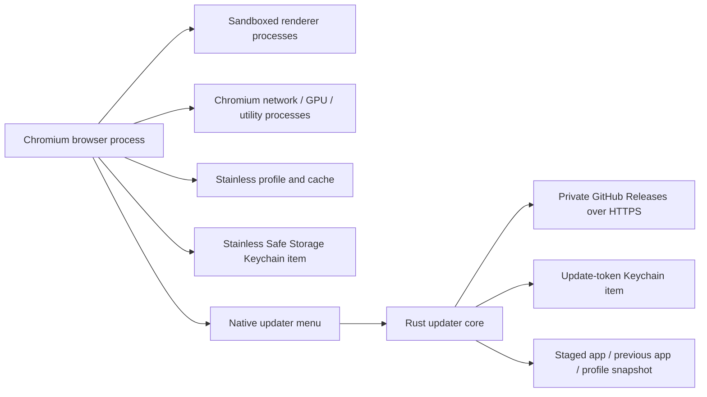

# Phase 1 baseline and release contract

Phase 1 is a real Chromium browser for Apple Silicon macOS, with unsigned private DMGs and
automatic unsigned updates. It is not complete until installed-browser evidence exists.

The repository now has a Rust coordinator, focused pinned Chromium patches, a Rust updater,
native Swift update menu, local packaging/publication commands and synthetic tests.
The full Chromium `chrome` target and matching ChromeDriver now compile on arm64 macOS 26.6
with Xcode/SDK 27.2, pinned Rust 1.99.1 and Metal Toolchain 27B47. Isolated actual-browser
checks pass for HTTP navigation/find/tabs, downloads, DevTools/PDF, history and cookie
persistence, Incognito isolation, and rejection of an untrusted HTTPS certificate.

The first private preview candidate includes a downloadable DMG, update ZIP/feed, final hashes,
build/source manifests and third-party notices. The DMG is installed and ejected locally before
repeating the real browser smoke with no developer tools on its PATH. The updater's production
ZIP extractor reconstructs a complete app whose ad-hoc signatures validate.

**Separate clean-Mac and authorized automatic N-to-N+1 evidence remain outstanding.**
Headless fixtures and simulated updater startup signals do not establish native UI,
sandbox inspection or the complete automatic-update release gate.

## Ownership and scope

| Surface | Phase 1 owner and implementation |
| --- | --- |
| Engine and normal browser UI | Chromium full `chrome` target, pinned in `chromium/manifest.json`; no renderer-only shell or alternate engine |
| Downstream changes | Five reviewable patches for identity, search/metrics, macOS updater hooks, branding and Google-service removal |
| Local development/release | Rust `tools/xtask`, exposed by `tools/stainless`; no hosted CI |
| Update policy/install | Rust `components/updater`; shared feed validation in `components/release` |
| Update status/credential entry | Native AppKit menu in `components/updater/macos/main.swift` |
| New WebUI/services | None until used by later phases |

Standard and inherited Incognito browsing are the initial modes. DuckDuckGo is the fallback
when no search provider has been chosen; explicit user/enterprise choices retain precedence.
Navigation, tabs/windows, bookmarks/history, find/zoom, downloads, print/PDF, settings,
certificate warnings and built-in DevTools remain Chromium features, not reimplemented UI.

The five-patch source baseline targets preview 4 and deliberately removes built-in Google
services. **Safe Browsing/reputation and password-leak protection have no replacement yet.**
Translation, cloud push and other removed capabilities stay unavailable; their
[replacement gaps](degoogling.md) do not mark the privacy roadmap complete.
Earlier preview binaries have their earlier service configuration.

Stainless is free and donation/sponsorship funded, with no ads, sponsored placements,
behavioral tracking or mandatory account/cloud AI. The complete v1 scope, exclusions and
per-capability owners remain in [the roadmap](roadmap.md) and
[epic #1](https://github.com/mbianchidev/stainless/issues/1).
Preview implementation does not expand that scope or mark cross-cutting issues complete.

## Inherited process and storage boundaries

The browser retains Chromium's site isolation, renderer/utility sandbox and certificate
validation. No packaging or smoke path may use `--no-sandbox`, ignore certificate errors
or require Google API credentials.

The browser process is trusted to access its ordinary Chromium profile. History/bookmarks
remain plaintext Chromium stores; OS-protected cookies/passwords use the separate
`Stainless Safe Storage` / `Stainless` service/account. The updater has file-level access
to snapshot/restore this profile after browser quit, but sends no profile/browsing data.
It is **not** Phase 2's metadata-only encrypted-profile coordinator or a sandboxed Mojo service.

Distinct identities are `dev.stainless.browser`, `Stainless.app`,
`~/Library/Application Support/Stainless`, `~/Library/Caches/Stainless` and the separate Keychain
items. Profiles are not silently imported from Chrome/Chromium. Native OS administrators,
compromised local builds and processes already running as the same user remain residual risks.

The separate [profile ownership/migration groundwork](profile-isolation.md) is an opt-in
developer tool with a versioned metadata-only registry, separate process/root leases and
copy-only recovery. It does not change installed preview behavior, add per-profile keys,
make the updater a metadata-only service, or establish whole-profile encryption.

## Network and privacy baseline

The patch forces production browsing/metrics consent off; the unbranded Chromium crash client
already refuses upload consent. Upstream code/signature changes must be re-reviewed on each
Chromium rebase. No custom browsing/crash telemetry endpoint is added.

No telemetry is not a no-network guarantee:

| Traffic | Baseline purpose and limits |
| --- | --- |
| User navigations, DNS and provider search | Normal browsing; direct DuckDuckGo search is not locally sanitized yet |
| Certificate/revocation validation | Normal inherited TLS checks remain required; removal does not waive certificate validation |
| Safe Browsing, Google component/extension delivery, portal/time/suggestions/variation checks | Disabled/unavailable in the five-patch baseline; lost protections/features and replacement owners are documented in the availability guide |
| GitHub API and release-asset hosts | Startup/periodic private update checks after initial user authorization |
| Google sign-in/sync and other Google-backed browser services | Disabled/unavailable; user-directed Google-site visits and explicit custom providers are separate |
| Widevine/proprietary codecs | Not supplied or promised by this unbranded/API-key-free build |

The inventory is a review checklist, not evidence that every potential service made a request
or was disabled. Capture synthetic first-run/idle/browsing traffic from the built candidate,
record actual destinations and purposes, and resolve telemetry discrepancies before release.
Offline or denied update access must never block normal browsing.

Full profile encryption, the custom vault, privacy containers, fingerprint protection, clean
search transforms, Tor, agents, AI, custom extension services and enhanced DevTools are not
implemented or advertised as Phase 1 protections.

## Update and rollback boundaries

Updates are opt-in private-download authorization followed by automatic checks/downloads,
not manual DMG replacement. Feed/schema/target/version/hash validation is shared between
publisher and client. Credentials live in Keychain and are not process arguments or feed data.
Payloads and metadata are unsigned: HTTPS and GitHub account/repository trust are explicit.

Every browser for the current OS user holds the same installation lock. Only after those
browsers stop can that user's updater atomically exchange the installed app under an exclusive
lock. The transaction journal and prior profile snapshot
survive interruption. A responsive startup marker confirms launch, not complete browsing health.
Only the unchanged Phase 1 profile schema is accepted. The opt-in copy-only profile tool does
not enable schema migrations or include managed roots in native automatic-update recovery.
The [installation guide](install-macos.md) documents restart, recovery and trust limitations.
The [clean-user update procedure](update-verification.md) defines safe provisioning,
automatic N-to-N+1 observations and the evidence to record without credentials or personal data.

## Release evidence

Keep all boxes open until supported by actual evidence tied to the release's source revision,
final asset hashes, hardware/OS matrix and installed version pair:

- [ ] Full pinned Chromium `chrome` builds and launches, with matching manifests and notices.
- [ ] Download the actual private DMG, verify its hash, install in Applications, eject it and
  browse on a separate clean user/host without source or developer tools.
- [ ] Exercise HTTP/HTTPS, ordinary search/fallback choice, tabs/windows, bookmarks/history,
  find/zoom, downloads, print/PDF, settings, certificate warnings and built-in DevTools.
- [ ] Verify restart/session/bookmark persistence, Incognito history isolation and distinct
  Chrome/Chromium paths/keychain identities using only synthetic data.
- [ ] Confirm native sandboxing, site isolation and certificate validation in the installed app;
  inspect actual background traffic and verify no automatic browsing/crash telemetry.
- [ ] Publish N and N+1, authorize the installed N updater with a user-scoped read-only token,
  and exercise automatic discovery/download/hash verification, controlled restart, N+1 launch
  and supported profile/session preservation without manually replacing the app.
- [ ] Exercise offline/denied access, bad hash, wrong target/version/schema, interrupted
  download/exchange, denied app-folder permission and failed launch/recovery.
- [ ] Verify removal and safe handling of retained apps, profiles, snapshots and credentials.
- [ ] Attach the release/version/evidence/limitations to epic #1 before calling Phase 1 complete.

Unit fixtures cover only their actual protocol/filesystem behaviors. They do not satisfy
clean-host or real installed-release gates. Loopback HTTPS fixtures exercise the production
download client with synthetic authorization and a test-only trust root; they do not prove
real private-release access, browser restart or session/bookmark preservation. A fresh upstream
provenance discrepancy also blocks a new candidate even when source tests pass.
Do not close #3/#5/#36/#37 or the cross-phase updater/security/architecture issues just because
tooling has been committed.

Public publication additionally requires a license/disclosure decision. No license has been
selected for Stainless; Chromium/Rust third-party notices and source obligations still apply
to private previews. Stable, production signing/notarization and additional platforms come later.
