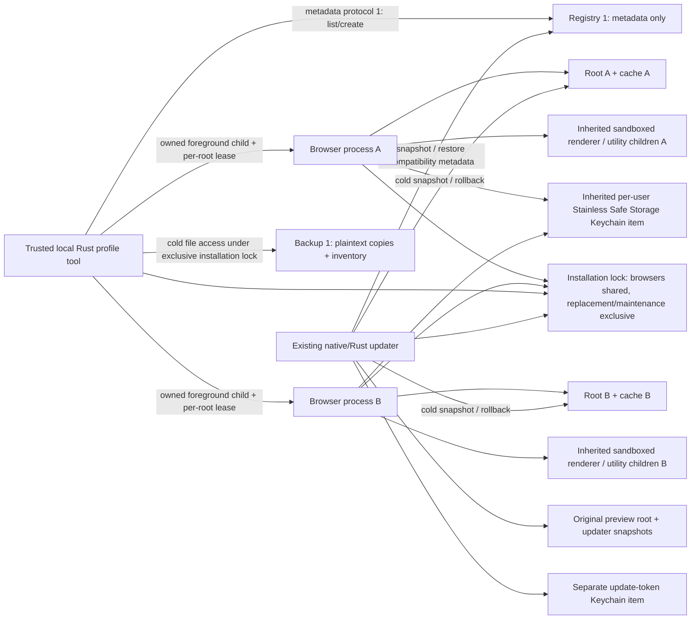

# Profile ownership, migration and update recovery

This is bounded groundwork for [#4](https://github.com/mbianchidev/stainless/issues/4) and the
first managed Standard/Incognito slice of #7, before #8's shell. It adds an opt-in Rust developer tool and integrates
registered roots into the native updater's recovery transaction, not installed onboarding or
a new browser release. Existing previews continue to open their original root.
It does not complete #4, Phase 1's [release evidence](phase-one.md#release-evidence), or
Phase 2's protected-data isolation gate.

**Separate roots and browser processes are not whole-profile encryption or an OS security
boundary between same-user browser processes.** History, bookmarks, preferences, sessions and
backups remain ordinary Chromium data. The current trusted browser/maintenance processes can
read those files. A metadata-only registry is not a sandboxed metadata-only coordinator.

## Versioned ownership

Registry format 1, metadata protocol 1 and manual backup format 1 are independent versions.
New native updater transactions use journal format 2, profile-snapshot format 1 and recovery-plan
format 1. Older installed helpers do not gain that coverage until replaced.
The product's existing `profile_schema` stays **1**. No encrypted-store migration, profile-data
schema bump, key rotation or downgrade conversion is introduced.
Unknown versions/fields, duplicate IDs, invalid IDs and unsupported data schemas fail closed;
the tool does not rewrite, reset or silently reconstruct an incompatible/missing registry.
The registry supports up to 256 profiles and 1 MiB of serialized metadata. Each backup/update
snapshot manifest and recovery plan is limited to 16 MiB; the updater snapshot limit covers
all roots combined. Write limits include pretty formatting and the final newline, so a
successful commit remains readable under the same byte limit.

All paths are derived beneath the current macOS user's home, never from labels or IPC paths:

```text
~/Library/Application Support/
  Stainless/                              Original preview user-data root, unchanged
  Stainless Updater/install.lock          Existing installation-wide browser/update lock
  Stainless Updater/backups/TRANSACTION/
    profiles.json                         Snapshot commit marker, registry and all file inventories
    profile/                              Original preview's cold copy, if it existed
    profiles/p-ID/                        Each registered managed root's cold copy
    recovery.json                         Rollback plan, directory identities and failed registry
  Stainless Profiles/
    registry.json                         Version, IDs, labels, schema, browser compatibility floors
    registry.lock                         Short-lived registry serialization
    profiles/p-ID/
      owner.lock                          Exclusive browser/maintenance lease for this root
      data/                               One complete Chromium user-data root
      cache/                              This profile's explicit disk-cache root; not backed up
      failed-TRANSACTION/                 Failed data retained after automatic rollback
    backups/b-ID/
      snapshot.json                       Commit marker, source metadata, SHA-256 file inventory
      data/                               Sensitive, plaintext cold copy
```

IDs are generated opaque names, not user-supplied paths. Managed directories are owner-only
`0700`; new metadata, locks and copied files are `0600`. Symlinked directories, aliased lock
files, hardlinked source files and unexpected symlinks/special files are rejected.
These checks prevent accidental aliasing and unsafe copies, not a malicious same-user process
racing filesystem operations.

The registry contains only IDs, user-entered labels, data schema and optional last-browser
product version/build/channel/Chromium version. It contains no URLs, tab/workspace contents,
history, bookmarks, cookies, credentials, vault data, key handles or arbitrary filesystem paths.
Labels are plaintext metadata too; use neutral names when identity labels are sensitive.
Backup inventories are separate from the registry and can reveal sensitive filenames.

Here, a managed profile means a **whole Chromium user-data root**. Existing Chromium
`Default`/`Profile N` subprofiles are copied together into one ownership group; they are not
silently split or advertised as separate security boundaries. The built-in profile picker, spaces and workspaces are not redefined by this slice.

## Process and key boundaries

Current architecture, version 2:



Standard launches supply derived `--user-data-dir` and `--disk-cache-dir` switches plus the
fixed managed-mode selector. No arbitrary browser arguments are accepted.
It owns the actual child handle and holds its profile lease and shared installation lock
until that child exits. No PID from a registry/request is trusted, attached to or killed.
Different roots can run concurrently; a second owner of the same root is rejected.
The app identity and compatibility floor are read/recorded while holding the installation
lock, before the browser can change storage. Failed spawn/launch retains that conservative floor.
Lower product builds/versions or Chromium versions cannot open the root, even if schema 1 matches.
The on-disk Chromium `Last Version` also prevents an older engine from opening externally
advanced data.

The tool waits in the foreground and never force-closes unsaved browser work. If its supervisor
dies, Chromium's existing installation lock and singleton remain additional protections.
A remaining `SingletonLock` is treated as ambiguous ownership, even if a PID appears stale.
Inspect it with every browser closed; the tool never deletes it or guesses which process to kill.
Actual Chromium singleton cleanup is inherited from the pinned POSIX/macOS implementation.

## Managed browsing modes

`profiles modes` reports the policy matrix without opening a registry or reading browsing
data. The actual consumer is the foreground `run`/`open` launcher, not a settings mock or a
replacement shell. Mode selection is immutable for that launch.

| Mode | Storage and identity | History and extensions | Network and downloads |
| --- | --- | --- | --- |
| Standard | The selected managed root and its existing local identity/passwords | Chromium's history preferences and user-controlled extensions | Ordinary direct networking; user-directed files persist |
| Managed Incognito | A new, owner-only temporary root/cache for each launch; no copied cookies, passwords, bookmarks, preferences or other profile files | Forced Chromium Incognito; no browsing history; extensions and password saving disabled | Ordinary direct networking, not anonymity; downloaded files persist outside the temporary root |
| Guest | Unavailable: memory-only storage, restricted downloads and guaranteed teardown are missing | Unavailable | Unavailable |
| Privacy Container | Unavailable: verified storage/network partitioning and privacy enforcement are missing | Unavailable | Unavailable |
| Developer | Unavailable: workspace trust and scoped developer capabilities are missing | Unavailable | Unavailable |
| Agent Sandbox | Unavailable: disposable isolation, approvals and resource ceilings are missing | Unavailable | Unavailable |
| Tor Proxy / Hardened Onion | Unavailable: verified routing, leak prevention and failure isolation are missing | Unavailable | Unavailable |

AI, agents and the custom vault are unavailable in every mode. Standard inherits Chromium's
ordinary behavior; this does not implement #7's future tracker-blocking/partitioning guarantees.
Guest is also unavailable in the new browser's native picker and command-line startup.

Managed Incognito requires an app declaring `StainlessManagedModesVersion = 1`; older apps
are rejected rather than silently ignoring enforcement. The downstream browser applies
immutable forced-Incognito, no-add-profile, no-password-saving, no-extension and no-background-mode
policies to that session. Standard remains account-free and can use local profiles and passwords.
These are source changes, not capabilities retroactively added to published previews.

The private root lives under `profiles/p-ID/incognito/s-ID/{data,cache}`. It holds its own
fresh browser process and the shared installation lock, so it can coexist with the selected
Standard profile but blocks replacement/maintenance until it exits. It neither opens the
persistent data root nor advances that root's compatibility floor. Cold profile backups and
update snapshots cover persistent data, not these temporary sessions.

After an observed normal or unsuccessful browser exit, the launcher explicitly removes that
session directory and reports cleanup failures. If child ownership is uncertain, it retains
the directory instead of deleting a potentially live browser's files. Killing the supervisor,
a crash or a power loss can leave temporary files; there is no memory-only, secure-erasure or
guaranteed-teardown claim. With the browser closed, remove only the exact retained session
directory identified by diagnostics. Downloads, OS caches and external observers are separate.

`open APP PROFILE_ID MODE URL` accepts only an explicitly supplied HTTP(S) URL without embedded
username/password credentials. No live tab, referrer, form state, cookies, credentials, storage
or artifacts are read or copied. Repeating the operation creates a fresh private session.
URLs can themselves contain sensitive query/fragment values; review them before transferring.
A Standard destination still uses **its own** existing identity; close it first if already
owned. No in-place tab conversion is provided.

Chromium's native New Incognito Window inside a Standard launch remains inherited behavior:
it can share that root's preferences, bookmarks and explicitly allowed extension/password
facilities. It is not the fresh-root managed launch described here. Neither path is an
OS-enforced boundary against a malicious same-user process.

| Key/data owner | Current boundary and deferred work |
| --- | --- |
| Each browser process | Owns one managed root and its renderer/utility state. Existing Chromium sandbox/site isolation/TLS stay enabled. Same-user browser processes are not denied each other's files by a new sandbox. |
| Chromium Safe Storage | Uses the existing `Stainless Safe Storage` / `Stainless` service/account. This is inherited protection for selected Chromium secrets, not separate profile keys or encryption of every store. |
| Updater | Trusted file-level access to the preview and registered roots while browsers are closed; not metadata-only authority. Its GitHub credential remains in `dev.stainless.browser.preview-updates` / `github-read-token`, separate from browsing secrets. The profile crate/tool has no credential-reading, network or Keychain dependency. |
| Future vault worker | Not implemented. It must own per-profile key generation/unlock/rotation, minimize/zeroize key bytes and exclude them from dumps. Only session-bound, profile-scoped, purpose-limited, revocable handles may cross its authenticated IPC boundary; never raw keys. |
| Future shell/coordinator | Must run with metadata-only authority and no decrypted-store/vault API or shared extension/storage process state. Separate sandboxed workers and versioned Mojo are required before claiming that enforcement. The local tool is not that service. |

No whole-profile-encryption algorithm, encrypted database format or recoverable key-export
scheme is selected here. The future migration must explicitly identify plaintext legacy data,
create/verify encrypted stores and backups, define key-loss/rotation behavior, and test that
the coordinator and other profiles cannot read plaintext. Existing OS administrators/kernel
compromise are out of scope; malicious sites/extensions/tools/models and compromised same-user
browser/maintenance processes remain threats for those later boundaries.

## Metadata request contract

The only implemented request operations are `list` and `create`:

```json
{"protocol_version":1,"request":{"operation":"list"}}
```

```json
{"protocol_version":1,"request":{"operation":"create","label":"Work"}}
```

Responses have `protocol_version`, `registry_version` and `profiles`; create returns the new
profile's metadata, list returns all registered metadata. Requests are limited to 16 KiB.
Unknown operations/fields/versions, paths, browser arguments, browsing-data and key requests
are rejected, rather than forwarded to a browser or another service.

This is a typed one-request stdin contract for future adaptation, **not an exposed IPC
listener**, authenticated transport or Mojo implementation. Launch, backup, import and restore
are separate, explicit local operator commands, not capabilities on the metadata endpoint.
Before any service is exposed, bind the OS peer identity and profile/session capability to
the connection, validate version/size at the receiving worker, deny ambient file/key authority,
and test confused-deputy, cross-profile handle reuse, disconnect and revocation behavior.
No renderer, extension, agent or model gets this operator CLI as an ambient tool.

## Preview backup, migration and restore rules

1. Quit every Stainless browser normally. Finish or recover a pending updater transaction.
   Import, backup and restore require the existing installation lock exclusively; creation and launch also
   refuses pending/unknown updater transactions, so it cannot advance a managed root during
   automatic failed-launch rollback. No operation requests administrator access or force-quit.
2. Explicit preview import requires the matching `Stainless.app`, product schema 1 and its
   exact Chromium `Last Version`. The source is only `~/Library/Application Support/Stainless`;
   Chrome/Chromium, custom paths and other OS accounts are not imported.
3. Inventory the closed source, copy it into a unique backup, verify all files and recheck the
   unchanged source. Persist/sync `snapshot.json` last as the backup commit marker. Only root
   runtime artifacts `SingletonLock`, `SingletonCookie`, `SingletonSocket`,
   `RunningChromeVersion` and `DevToolsActivePort` are omitted; a present singleton lock already
   blocks the operation. Other unexpected links/files are errors, not silently skipped.
4. Copy the frozen backup into a new managed root and verify its inventory again. Atomically
   persist/sync the registry last. The original preview and backup are never moved, overwritten
   or deleted, and migration never launches a browser automatically.
5. Managed backups require the recorded browser identity to match the root's version.
   Restore checks the backup format/schema/inventory and copies into a **new ID/root** with its
   captured compatibility floor. The current/failed root, registry entries and backup remain
   available. An older app is allowed only on a compatible older snapshot, never by rewinding
   the compatibility floor on the live root.

Missing commit markers, corrupt/incomplete copies, incompatible formats, disk/permission
failures and source changes produce errors without replacing original data. Unregistered
profile directories and incomplete backups are retained with their paths in the error.
The explicit profile commands do not adopt orphans, prune backups or overwrite an existing
profile on restore. Automatic update rollback has the separate transactional rules below.
After a durability error, inspect the registry/commit marker before retrying: an atomic rename
may already have succeeded even if a later directory sync failed.

Keep the matching prior app and its release/build manifests yourself; profile backups do not
contain an application bundle or export Keychain items. Restore is same-account data recovery,
not a promise that cookies/passwords can be decrypted on another account/Mac. External
extension/download resources referenced by Chromium preferences are not copied from arbitrary
host paths. These backups contain sensitive plaintext, not an encrypted vault.

## Native multi-root update recovery

The updater acquires the exclusive installation lock, then the registry lock and every
registered root's owner lease. It snapshots the preview, every registered managed data root
and their exact registry metadata before replacing the app. It uses the same verified
cold-copy, no-follow and compatibility helpers as manual backups. An unreadable, missing,
aliased, owned, unpaired or incompatible registered root blocks the **entire** installation;
it is never silently skipped. A preview-only install does not create a managed registry.
Custom/unregistered roots and managed disk caches are not included.

The old app must be compatible with every captured root and the candidate cannot lower its
product/Chromium floor. `profiles.json` is committed last, before journal format 2 authorizes
app exchange. Creation, launch, import, backup and manual restore refuse pending or unknown
transactions; metadata listing remains available. Managed launches still use `--user-data-dir`
and do not start an independent update/health helper. Confirm the default preview's update
before opening them.

On failed startup, recovery verifies every snapshot and prepares every replacement before
committing `rolling_back`. Its durable plan records the original/prepared directory device
and inode identities, so an interrupted exchange cannot be replayed backwards. Each failed
root remains available: the preview beside its original path as
`.Stainless.failed-profile-TRANSACTION`, and each managed root under
`profiles/p-ID/failed-TRANSACTION/`. The plan retains the failed registry, including any
compatibility floor advanced to this candidate.

Only after all data roots are restored does recovery atomically restore their captured
registry/floors, exchange the app back and commit `rolled_back`. A late startup marker cannot
override `rolling_back`. Errors leave the journal nonterminal and the new app in place until
data/metadata restoration completes; an interruption after app exchange must still reconcile
the recorded roots. Partial restoration is not reported as successful rollback. Retry after
closing browsers and repairing the reported permission/storage problem. Unexpected registry
entries, changed restored data or displaced directory identities require explicit recovery,
not overwriting newer work. Interrupted preparation may retain owner-only `r-ID/` copies
beside the affected root; keep them while recovery is pending.

**First-upgrade limitation:** a transaction prepared by an older installed updater contains
only the preview snapshot. New code can read that legacy journal and convert preview-only
rollback to the resumable plan, but cannot invent historical managed snapshots. With
registered roots, missing legacy coverage blocks automatic rollback rather than omitting
them, even if an old helper already exchanged the app back. Before that first transition,
keep explicit managed backups and the matching prior app. A successful legacy startup does
not retroactively prove managed-root recovery.

This is source-level recovery integration, not a published browser or clean-host update
demonstration. Snapshots/failed roots remain plaintext, do not export Keychain items and are
not authenticated against same-user tampering.

## Developer usage and evidence

```sh
./tools/stainless profiles help
./tools/stainless profiles modes
./tools/stainless profiles list
./tools/stainless profiles create "Work"
./tools/stainless profiles import-preview /Applications/Stainless.app "Imported preview"
./tools/stainless profiles run /Applications/Stainless.app p-IDENTIFIER
./tools/stainless profiles run /Applications/Stainless.app p-IDENTIFIER incognito
./tools/stainless profiles open /Applications/Stainless.app p-IDENTIFIER incognito https://example.com/
./tools/stainless profiles backup p-IDENTIFIER
./tools/stainless profiles restore b-IDENTIFIER "Recovered copy"
printf '%s\n' '{"protocol_version":1,"request":{"operation":"list"}}' |
  ./tools/stainless profiles metadata
```

Replace example IDs with the full generated IDs returned by the tool. These commands do not
need full Xcode, a clean Mac, updater credentials or a Chromium fetch/build. They do need the
repository's pinned Rust toolchain; installed browsers do not gain a compiler dependency.

| Risk | Implemented protection and synthetic evidence | Residual/release boundary |
| --- | --- | --- |
| Wrong-root routing or concurrent ownership | Two synthetic child processes receive distinct roots/caches; duplicate ownership and installation replacement are blocked until exit. | Not real-browser sandbox enforcement or proof of protected-data non-readability. |
| Live/inconsistent migration | Shared updater/browser lock, singleton refusal, pending-transaction checks, verified cold copies. | Unknown/manual browser builds must not bypass the inherited installation lock. |
| Data loss or incompatible restore | Original and failed roots retained; clone restore, hashes, commit markers, schema/version floors, interrupted-copy/future-format rejection. | Real bookmark/session/native restart and clean-host recovery need candidate-specific evidence. |
| Partial automatic rollback | Multi-root snapshot rejection, per-root/app exchange interruption, durable registry/floor restoration, permission-repair retry and legacy-coverage refusal. | A previously published helper cannot snapshot managed roots retroactively; real installed multi-root recovery remains an open release gate. |
| Filesystem/metadata substitution | Strict IDs/fields, duplicate/path rejection, no-follow regular-file checks, directory/link checks. | Same-user attackers can tamper with files and hashes together; inventories are corruption checks, not authenticated backups. |
| Confused-deputy/key leakage | Metadata-only request/response shapes reject paths, launch arguments, browsing/key operations and oversized/unknown requests. | No running Mojo service, per-profile key context, encrypted store or sandboxed coordinator yet. |

`cargo test --locked -p stainless-profiles -p stainless-updater --lib` exercises these cases
using fictional data, app manifests/processes and native filesystem exchanges. Source fixtures
do not satisfy the broader issue's encrypted-data isolation
acceptance criteria or close the installed-browser release gates.
