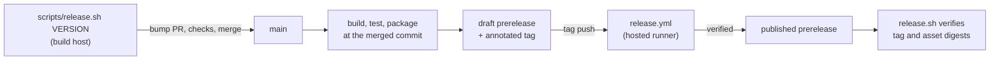

# Releasing Stainless

Releases are maintainer-only. Stainless uses a **hybrid release**: the browser is built and
packaged on a dedicated macOS build host, and a tag-triggered GitHub Actions workflow
re-verifies the uploaded draft and publishes it.

Hosted runners cannot build Chromium (standard `macos-26` runners have 3 CPUs, 7 GB of memory,
14 GB of disk and a 6-hour job limit, while a Stainless build needs 100+ GB and hours of
compilation), so CI never compiles the browser. It verifies what the build host uploaded.



## Requirements

- A **dedicated macOS build host or VM** with its own GUI session and no forwarded personal
  keyboard input. `test` and `package` launch AppKit helpers and the full browser smoke; see
  [native GUI-test isolation](build-macos.md#native-macos-gui-test-isolation). The script
  refuses to build without `--isolated-host`.
- Everything in the [build guide](build-macos.md#requirements): Apple Silicon, full Xcode,
  the Chromium cache (`./tools/stainless bootstrap` done once) and free disk.
- `gh` authenticated for github.com with permission to push branches and tags, open and merge
  pull requests and create releases in `mbianchidev/stainless`.
- `cargo-audit` (`cargo install cargo-audit --locked`) and `python3`.
- A Git remote (default `origin`) whose fetch and single push URL both point to
  `github.com/mbianchidev/stainless`. Run the script from an up-to-date `main` checkout: it
  refuses to run when its own files differ from the release base.

## Release a version

Preview the plan first. A dry run creates no branch, PR, build, tag or release:

```sh
./scripts/release.sh --dry-run 0.1.0-preview.9
```

Then release on the build host:

```sh
./scripts/release.sh --isolated-host 0.1.0-preview.9
```

| Option | Meaning |
| --- | --- |
| `-n`, `--dry-run` | Show the plan only |
| `--isolated-host` | Confirm the dedicated build host; required when a build will run |
| `--jobs N` | Chromium build parallelism, 1 to 64 (default 8) |
| `--remote R`, `--base B` | Release remote and base branch (defaults `origin`, `main`) |

`STAINLESS_CACHE_DIR` is passed through to `./tools/stainless`. Waits are bounded by
`STAINLESS_RELEASE_CHECKS_TIMEOUT` (600 s for PR checks to appear),
`STAINLESS_RELEASE_MERGE_TIMEOUT` (1800 s), `STAINLESS_RELEASE_RUN_TIMEOUT` (600 s for the
release workflow to appear) and `STAINLESS_RELEASE_POLL_INTERVAL` (10 s).

### Versions

Stainless only implements the preview channel, so versions have the form
`MAJOR.MINOR.PATCH-preview.N` ([SemVer 2.0.0](https://semver.org/spec/v2.0.0.html)) and an
optional leading `v` is accepted. Build metadata is rejected because the product manifest
cannot carry it. The tag is `stainless-preview-vVERSION`.

The script compares versions by SemVer precedence. It rejects a version older than the
release base or a published release, and warns before any work when the version skips values,
for example `0.1.0-preview.4` to `0.1.0-preview.8` (previews 5 to 7 were never published) or
`0.1.0` to `0.3.0`. Warnings never change the requested version. A new version increments
`product.build` by one, keeping updater builds monotonic.

## What the script does

1. **Preflight.** Validates the version, tools, `gh` authentication, remote identity, the
   script's freshness against `origin/main` and existing PR, tag, draft and package state.
   One release runs at a time per repository (lock in the Git common directory).
2. **Bump PR** (only when `main` does not already carry the version). In a temporary
   worktree from fresh `origin/main` it sets `product.version`/`product.build` in
   [`chromium/manifest.json`](../chromium/manifest.json), runs `security-status` and
   `cargo audit`, commits `release: VERSION` (unsigned, no editor), pushes
   `release/VERSION` and opens a ready PR. It shows `gh pr checks --watch`, requires every
   check to pass and the head to be unchanged, then runs
   `gh pr merge --auto --squash --match-head-commit`. gh merges immediately when the PR is
   clean, or enables auto-merge when repository rules still block it; the script waits for
   the actual merge and uses its merge commit. It never bypasses repository rules.
3. **Build and package** in a temporary detached worktree at the release commit:
   `security-status`, `cargo audit --deny warnings`, `test`, `build --jobs N` and `package`.
   `test` runs before `build` because it rebuilds the updater UI whose hash `build` records.
   The package moves to `dist/VERSION` in your checkout, preserving earlier packages.
4. **Stage.** `./tools/stainless publish dist/VERSION` re-verifies the package (checksums,
   clean source revision equal to the release commit, license and security policy, current
   Chromium stable, RustSec) and uploads it to a **draft** prerelease targeting that commit.
5. **Tag.** Creates and pushes the annotated `stainless-preview-vVERSION` tag at the release
   commit. It never force-pushes or moves a tag.
6. **Release CI.** Finds the [`release.yml`](../.github/workflows/release.yml) run for that tag
   and commit and shows `gh run watch`. On failure it prints the failed-step log and run URL.
7. **Verify.** Requires a published prerelease, the remote tag at the release commit and
   every asset name, size and `sha256` digest to match `SHA256SUMS`.

The script never modifies tracked files in your checkout: the version bump happens in an
owned worktree, and only `dist/VERSION` and the local tag are left behind. Interrupts
(Ctrl-C or SIGTERM) are forwarded to `./tools/stainless` as SIGTERM so it can stop its smoke
helpers, and owned worktrees are removed on every exit.

## Release CI

[`release.yml`](../.github/workflows/release.yml) runs only for pushed
`stainless-preview-v*` tags, on a hosted `macos-26` runner with `contents: write` limited to
that job. Runs for the same tag never cancel each other. It:

1. Requires an annotated tag on `main` that matches the source manifest version.
2. Requires a staged prerelease; a draft must target the tagged commit.
3. Downloads every asset and runs `./tools/stainless verify-release`: `SHA256SUMS` and no
   unlisted assets, the update feed, a clean build from the tagged commit, the packaged
   license and `SECURITY.md`, **current Mac Stable Chromium** and `cargo audit`.
4. Checks the uploaded asset digests reported by GitHub against `SHA256SUMS`.
5. Publishes the draft as a prerelease and confirms the tag still points to the commit.

**Trust boundary.** CI proves that the published assets are exactly the files the build host
recorded in `SHA256SUMS`, built from a clean checkout of the tagged commit, and that the
Chromium pin and Rust dependencies are current at publication. It does not rebuild or
re-smoke the browser, so it cannot prove the binaries are reproducible, and previews remain
unsigned and unnotarized. The build host and the maintainer's GitHub credentials stay in the
trust base.

## Recover from a failure

Fix the cause and rerun the same command. The script reconstructs state from GitHub and
`dist/VERSION`; tag, draft and package must agree on one release commit.

| Stopped at | Rerun behavior |
| --- | --- |
| Validation, before the PR | Nothing was pushed; starts again |
| PR checks failed or merge refused | The PR stays open; fix it there (or merge it per repository rules), then rerun to resume the same PR |
| Build, test or package failed | The merged bump is reused; rebuilds at the same commit (Chromium output in the cache is incremental) |
| Staging failed with a partial draft | Inspect `gh release view TAG`, delete only that unpublished draft, then rerun |
| Release workflow failed | The draft stays unpublished; rerun to rerun the failed jobs once and watch them. If the fix needs new source, release a new version |
| Already published | Verifies the release, tag and digests; publishes nothing |

The script refuses conflicting state instead of overwriting it: a tag pointing elsewhere, a
package from another commit (move `dist/VERSION` aside), several or closed bump PRs, a local
`release/VERSION` branch without a PR, or a release that appears during the build.

## Manual equivalent

Without the script, from a clean checkout of the release commit on the build host:

```sh
./tools/stainless security-status && cargo audit --deny warnings
./tools/stainless test
./tools/stainless build --jobs 8
./tools/stainless package
./tools/stainless publish dist/VERSION   # uploads a draft only
git tag -a stainless-preview-vVERSION -m "release: VERSION" && git push origin stainless-preview-vVERSION
```

## Homebrew

**Decision (2026-11-18): publish Stainless as a cask in
[`mbianchidev/homebrew-tap`](https://github.com/mbianchidev/homebrew-tap).** The tap is the
only writer: its hourly updater picks the highest published `stainless-preview-v*` prerelease,
checks the asset against this release's `SHA256SUMS` and opens the bump PR there. This
repository holds no tap credentials and the release ends at published, checksummed assets.
The cask keeps macOS quarantine and is not available until
[mbianchidev/homebrew-tap#41](https://github.com/mbianchidev/homebrew-tap/pull/41) merges.

## After publishing

Publication is not a Phase 1 completion claim. Record actual clean-host download and install,
baseline browsing and installed N-to-N+1 update and recovery evidence as described in the
[Phase 1 contract](phase-one.md#release-evidence) and the
[update verification procedure](update-verification.md).

The release tooling is covered by `tests/release_script_test.py` (run by
`./tools/stainless test` and CI), which exercises the script against a synthetic Git remote,
GitHub CLI and build tools.
